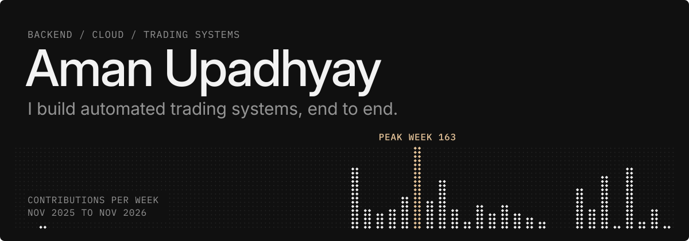
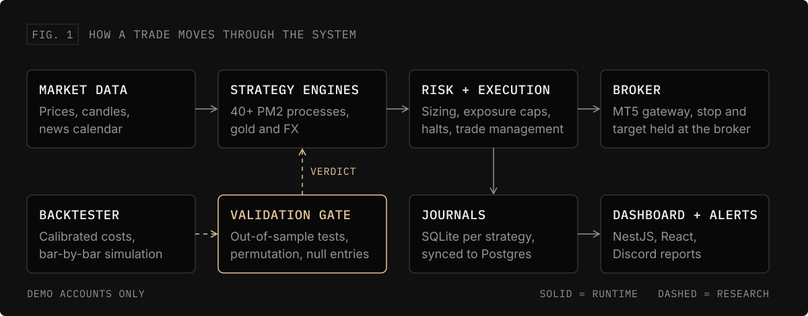

B.Tech in Computer Science (Cloud Computing and Automation) from VIT Bhopal, and AWS Cloud Practitioner certified.

Since May 2026 I've been building and running an automated trading platform as a solo project, with Claude Code as my pair programmer. I cover the whole stack: strategy research, order execution, dashboards, and the Linux server it runs on. It trades demo accounts only, so this is an engineering story, not a profit claim.

<table>
  <tr>
    <td align="center" width="25%"><h3>1,390+</h3>commits since May 2026</td>
    <td align="center" width="25%"><h3>4,000+</h3>automated Python tests</td>
    <td align="center" width="25%"><h3>40+</h3>processes on one server</td>
    <td align="center" width="25%"><h3>35+</h3>strategy families tested</td>
  </tr>
</table>

### What I'm building

#### Algorithmic trading platform

`Python` `NestJS` `React` `PostgreSQL` `Docker` `Oracle Cloud`

More than 40 processes watch gold and FX markets 24 hours a day, five days a week. They place orders with the stop and target held at the broker, and report to a web dashboard and Discord.

- **A validation gate for strategies.** Each idea faces out-of-sample, permutation and random-entry tests, with trading costs calibrated from broker data. Of about 37 strategy families tested by September 2026, almost none survived. Its job is to predict live results, not to pass strategies.
- **Safety guards proven by mutation testing.** I break a guard on purpose and confirm a test fails. If nothing fails, the guard wasn't really tested.
- **A full broker migration.** I moved the whole fleet from OANDA's REST API to MetaTrader 5 through [Termless](https://termless.imemyself.dev), a friend's gateway, with snapshots ready for rollback.
- **Deploys that can't half-finish.** Files are staged and hash-checked before they go live, so a dropped connection can't leave broken code on the server.

#### Matrix

`TypeScript` `Fastify` `React` `PostgreSQL` `TimescaleDB`

A ground-up rewrite of the platform: one Node process and one database in place of a fleet of Python processes, with a dashboard that updates in real time over WebSockets. Test fixtures generated by the Python version check that both systems produce the same results.

Both repos are private, so you won't see them in my repository list. I'm happy to walk through the code on a call.

### Earlier work

- **Web Developer, Ethnus** (Aug to Nov 2023): built a responsive website with React, Node.js and MongoDB.
- **Team projects** (2022 to 2023): led teams of four on a food ordering website and a ticketing website.
- **[Personal Finance Dashboard](https://github.com/AmanUpadhyay29/Personal_Finance_Dashboard)**: dashboard UI in HTML and Tailwind CSS.

### Tech

**Languages**\

\
**Backend**\

\
**Frontend**\

\
**Data**\

\
**Cloud and ops**\

\
**Tools**\

### Get in touch

[Email](mailto:amanupadhyay2905@gmail.com) | [LinkedIn](https://www.linkedin.com/in/aman-upadhyay-16654422b/)
